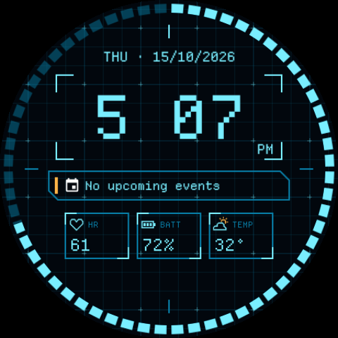

# Syswatch 01

Syswatch 01 is a custom Samsung Wear OS watch face inspired by early-2000s hacker software, technical monitoring systems, Y2K computer interfaces and restrained cyan science-fiction HUDs.

<p align="center">
  
</p>

<p align="center"><em>Captured from a Galaxy Watch9 with live data. Earlier iterations are in <a href="watch-face/captures/">watch-face/captures/</a>.</em></p>

**Get it:** download the APK from the [latest release](https://github.com/maxontorres/syswatch-01/releases/latest) and follow [INSTALL.md](INSTALL.md). It is free, sideloaded over wireless debugging, and needs Wear OS 5 or newer.

This repository (`syswatch-01`) is the sole source of truth for the project. Nothing needed to continue the work lives outside it.

| If you are… | Start with |
| --- | --- |
| A developer | This file, then [docs/ROADMAP.md](docs/ROADMAP.md) |
| An AI coding assistant | This file, then [AGENTS.md](AGENTS.md) |
| Changing anything visual | [docs/DESIGN-SPEC.md](docs/DESIGN-SPEC.md) and [docs/DECISIONS.md](docs/DECISIONS.md) |

## Project status

Verified against the repository and a physical watch on 2026-10-15. Details and checkboxes are in [docs/ROADMAP.md](docs/ROADMAP.md).

| State | What |
| --- | --- |
| **Implemented** | The `asset-generator`: a deterministic Node.js pipeline that writes 19 production assets (15 icons, 4 structural) as SVG and PNG, a manifest, a semantic weather mapping, four HTML preview pages and 74 automated checks. |
| **Implemented in Watch Face Studio and running on a watch** | Version 1 face in [watch-face/](watch-face/README.md): clock, AM/PM, date, next event with the system calendar icon, seconds ring, heart rate, battery with a low-battery amber state, weather icon by condition with temperature, and an always-on layout. Installed and checked on a Galaxy Watch9 on 2026-10-15. |
| **Generated and visually reviewed** | The production preview (`asset-generator/dist/previews/production-preview.png`): one 450×450 face with sample data. It is the generator's reference image, not the watch face. The watch face differs from it; see [docs/DESIGN-SPEC.md](docs/DESIGN-SPEC.md#watch-face-studio-version-1-as-built). |
| **Not implemented** | Compass shortcut (no position on the face), rain probability (the weather module shows temperature instead). |
| **Still to test on the watch** | Long event titles with real calendar data (blocked: Bluetooth was off), weather icons across several real conditions, legibility outdoors, battery drain over a day. |
| **Future ideas** | Live compass heading, distance from home, gym routines, a custom navigation interface, a native Wear OS implementation. |

## Version 1 features

Status of each feature on the watch, checked on 2026-10-15.

| Feature | Specification | Status |
| --- | --- | --- |
| Clock | 12-hour | Running on the watch |
| Hour format | No leading zero for single-digit hours (`6:42`, not `06:42`) | Running (`4:04` seen on the watch) |
| AM/PM | Small indicator below the clock, right-aligned | Running |
| Date | Weekday and date as `DD/MM/YYYY`, for example `SAT · 10/10/2026` | Running |
| Next calendar event | One line in the event strip, system calendar icon on the left | Running; empty state `No upcoming events` seen on the watch |
| Seconds | Progress ring around the edge, driven by `[SEC]` | Running |
| Heart rate | Data module; tap opens Heart rate | Running |
| Battery | Percentage, data module; amber at 15 % or less; tap opens Battery | Running; amber seen at 10 % and 15 % |
| Weather | Condition icon from the generated set, and temperature; tap opens Samsung Weather | Running |
| Rain | Probability in percent | Not implemented in Version 1 ([D-023](docs/DECISIONS.md#d-023-weather-module-shows-temperature)) |
| Compass | Shortcut that opens the Compass app | Not implemented: no position on the face |
| Always-on display | Dimmed time, AM/PM and date only | Running; checked by eye on the watch |

### Explicit Version 1 exclusions

These are not built and must not be faked with static or invented data:

- Live geographic compass heading
- Distance from home
- Full gym routine management
- Custom navigation interface

The compass is initially a **static shortcut to the Compass app**. Its icon is a fixed four-point rose, deliberately not a needle, so it cannot be mistaken for a live heading.

## Visual identity

- Near-black/navy background
- Cyan technical grid, low contrast
- Bright cyan for primary data
- Darker cyan for structural elements
- Small amber status accents, one "signal" element at a time
- Angular HUD framing: brackets, chamfers, 45° and 90° angles
- Restrained effects: no blur, gradients, shadows or filters in any asset
- No excessive glow
- No generic rounded mobile-app styling

The canonical specification is [docs/DESIGN-SPEC.md](docs/DESIGN-SPEC.md).

## Typography

Both fonts are bundled, unmodified, each beside its licence. This was verified by the build (family name, version, OFL notice and SHA-256 checksums).

| Role | Font | Bundled file | Size on the 450×450 canvas |
| --- | --- | --- | --- |
| Main clock | Departure Mono Regular 1.500 | `asset-generator/assets/fonts/departure-mono/DepartureMono-Regular.otf` | **99 px** (9× its 11 px design size), tracking 0 |
| AM/PM | Departure Mono Regular 1.500 | same | 22 px (2×) |
| Date | Share Tech Mono Regular 1.003 | `asset-generator/assets/fonts/share-tech-mono/ShareTechMono-Regular.ttf` | 20 px, tracking 1 px |
| Next event | Share Tech Mono Regular 1.003 | same | 16 px, tracking 1 px |
| Module values | Share Tech Mono Regular 1.003 | same | 16 px |
| Module labels | Share Tech Mono Regular 1.003 | same | 12 px |

Rules:

- Departure Mono is a pixel font. Use it only at whole multiples of 11 px, at whole-pixel positions, with one uniform scale and no smoothing.
- Tabular numerals: Departure Mono includes an OpenType `tnum` feature and is monospaced. Share Tech Mono has no `tnum` feature but is monospaced, so its numerals are tabular as drawn.
- In the generator, text is drawn as vector outlines taken from the font files.
- **In the Watch Face Studio project, Departure Mono sets all text**, including the date, event and module text; Share Tech Mono is not bundled in the `.wfs` ([D-022](docs/DECISIONS.md#d-022-departure-mono-for-all-text-in-the-watch-face-studio-build)). On the watch it renders as crisp pixels. Sizes in the project differ from the table above; see [watch-face/README.md](watch-face/README.md#layer-structure).

## Color tokens

Actual values from `asset-generator/design-tokens.json`:

| Token | Value | Use |
| --- | --- | --- |
| `color.background` | `#02070D` | Background |
| `color.primary` | `#79EEFF` | Primary cyan: clock, data, icons, active ring |
| `color.secondary` | `#087DA6` | Secondary cyan: grid, frames, labels, inactive ring |
| `color.accent` | `#FFB347` | Amber accent |

## Repository structure

```
syswatch-01/
├── README.md                   this file, the human entry point
├── AGENTS.md                   operating rules for AI coding agents
├── CLAUDE.md                   Claude Code entry point (reading list only)
├── .gitignore
├── docs/                       specifications and guides (see below)
├── asset-generator/            the generator (Node.js)
│   ├── README.md               generator-level reference
│   ├── package.json            npm scripts and dependencies
│   ├── package-lock.json       locked dependency versions
│   ├── design-tokens.json      colours, sizes, strokes, grid, ring, typography
│   ├── assets/fonts/           bundled fonts, each beside its licence
│   ├── src/                    asset and layout definitions (the source of truth)
│   ├── scripts/                generate and validate scripts
│   └── dist/                   generated output, committed, never edited by hand
│       ├── svg/                19 production SVGs + numerals/ (experiments)
│       ├── png/                19 production PNGs + numerals/ (experiments)
│       ├── previews/           4 HTML pages and their renders
│       ├── manifest.json       asset and font inventory
│       └── weather-mapping.json  semantic weather label to icon name
├── watch-face/                 the Watch Face Studio project
│   ├── README.md               layer structure, preview and deployment
│   ├── Syswatch 01.wfs         the Version 1 project (Watch Face Studio 1.9.9)
│   └── captures/               screen captures from the physical watch
└── references/                 planned: concept images (empty)
```

`references/` is empty. Git does not track empty directories, so it does not exist in a fresh clone. See [docs/TROUBLESHOOTING.md](docs/TROUBLESHOOTING.md#empty-directories-are-not-tracked-by-git).

| Document | Canonical for |
| --- | --- |
| [docs/DESIGN-SPEC.md](docs/DESIGN-SPEC.md) | Visual and behavioural specification |
| [docs/DECISIONS.md](docs/DECISIONS.md) | Locked decisions and their rationale |
| [docs/ASSET-PIPELINE.md](docs/ASSET-PIPELINE.md) | How assets are generated, validated and extended |
| [docs/WATCH-FACE-STUDIO.md](docs/WATCH-FACE-STUDIO.md) | Watch Face Studio tags, findings and test status |
| [watch-face/README.md](watch-face/README.md) | The `.wfs` project: layers, weather mapping, deployment |
| [docs/LICENSING.md](docs/LICENSING.md) | Fonts, dependencies, original assets |
| [docs/ROADMAP.md](docs/ROADMAP.md) | Remaining work, by phase |
| [docs/TROUBLESHOOTING.md](docs/TROUBLESHOOTING.md) | Known problems and fixes |
| [asset-generator/README.md](asset-generator/README.md) | Generator internals |

## Setup

Requires Node.js and npm (verified with Node 22.22.0 and npm 11.19.0). Windows PowerShell:

```powershell
git clone <repository-url> syswatch-01
cd syswatch-01\asset-generator
npm ci
npm run build
Start-Process .\dist\previews\production-preview.html
```

No Git remote is configured in the working copy this was verified in, so `<repository-url>` has no known value yet.

All npm commands run from `asset-generator`, not from the repository root.

## npm scripts

Read from `asset-generator/package.json`.

| Command | Runs | What it does |
| --- | --- | --- |
| `npm run generate` | `scripts/generate-icons.mjs` | Writes the 19 production SVGs, exports each to PNG, writes `manifest.json` and `weather-mapping.json`, removes stale files. |
| `npm run preview` | `scripts/generate-preview.mjs` | Writes `dist/previews/index.html`. |
| `npm run validate` | `scripts/validate-assets.mjs` | 22 checks on the production assets, manifest, mapping and asset preview. |
| `npm run generate:numerals` | `scripts/generate-numerals.mjs` | Writes the 3 experimental numeral families (33 glyphs) and `numeral-lab.html`. |
| `npm run validate:numerals` | `scripts/validate-numerals.mjs` | 21 checks on the numeral output. |
| `npm run generate:clock-font` | `scripts/generate-clock-font.mjs` | Renders 27 comparison faces and writes `clock-font.html`. |
| `npm run validate:clock-font` | `scripts/validate-clock-font.mjs` | 18 checks on fonts, licences, checksums, pixel geometry and comparison renders. |
| `npm run generate:production` | `scripts/generate-production-preview.mjs` | Renders `production-preview.png` and writes `production-preview.html`. |
| `npm run validate:production` | `scripts/validate-production-preview.mjs` | 13 checks on the production face and page. |
| `npm run build` | all of the above | The five generate steps in the order above, then the four validations. Stops at the first failing step. |

There is no test, lint or watch script.

## Preview files

All in `asset-generator/dist/previews/`. They are self-contained and open directly from disk.

| File | Purpose |
| --- | --- |
| `production-preview.html` | **The production preview.** One 450×450 face with the locked typography, a typography table and the visual hierarchy. Start here. |
| `production-preview.png` | The 450×450 render shown by that page. |
| `index.html` | Asset preview: every icon at 16, 24, 32 and 64 px, the four structural assets, and two composed faces. The clock on its composed face is placeholder HTML text, not Departure Mono. |
| `clock-font.html` | Clock font comparison: Departure Mono at 88, 99 and 110 px, three sample times, three trackings. Kept as the evidence for the 99 px decision. |
| `clock-font/*.png` | The 27 renders shown by that page. |
| `numeral-lab.html` | The three experimental numeral families. Superseded by Departure Mono; kept for reference. |

Every value on every preview is **sample data**.

## Asset inventory

Filenames confirmed against `asset-generator/dist/manifest.json` (`assetCount`: 19). Each asset exists as `dist/svg/<name>.svg` and `dist/png/<name>.png`.

**General icons** (manifest category `icon-interface`, 64×64, transparent)

| Feature | Name |
| --- | --- |
| Calendar | `calendar` |
| Heart | `heart` |
| Battery | `battery` |
| Compass | `compass` |

**Weather icons** (manifest category `icon-weather`, 64×64, transparent)

| State | Name |
| --- | --- |
| Unknown | `weather-unknown` |
| Clear | `weather-clear` |
| Partly cloudy | `weather-partly-cloudy` |
| Cloudy | `weather-cloudy` |
| Fog | `weather-fog` |
| Rain | `weather-rain` |
| Heavy rain | `weather-heavy-rain` |
| Snow | `weather-snow` |
| Storm | `weather-storm` |
| Sleet | `weather-sleet` |
| Wind | `weather-wind` |

**Structural assets** (manifest category `structural`, 450×450)

| Asset | Name | Transparent |
| --- | --- | --- |
| Background grid | `background-grid` | No (opaque `#02070D`) |
| HUD frame | `hud-frame` | Yes |
| Seconds-ring base | `seconds-ring-base` | Yes |
| Seconds-ring active | `seconds-ring-active` | Yes |

**Not in the manifest**

- Experimental numerals: `dist/svg/numerals/<family>/` and `dist/png/numerals/<family>/` for `sys-stencil`, `sys-matrix` and `sys-bus`; files `0`–`9` and `colon`, 33 SVG and 33 PNG in total. Not production assets.
- Preview renders under `dist/previews/`.

## Build verification

`npm run build` generates everything and then runs four validators. Each prints one `PASS` or `FAIL` line per check and exits non-zero on any failure, which stops the build.

Expected successful output, in this order:

```
generated 15 icons and 4 structural assets (SVG + PNG)
wrote previews/index.html
generated 3 numeral families, 33 glyphs (SVG + PNG)
wrote previews/numeral-lab.html
rendered 27 clock font faces (88, 99, 110 px x 3 times x 3 trackings)
wrote previews/clock-font.html
rendered previews/production-preview.png
wrote previews/production-preview.html
22/22 checks passed
21/21 numeral checks passed
18/18 clock font checks passed
13/13 production preview checks passed
```

What the validators enforce, in short: the exact set of expected assets; that every SVG on disk equals its JavaScript definition (so hand edits fail); no text, rasters, filters or gradients in SVGs; PNG sizes and transparency; 60 evenly spaced ring segments; font identity, licence text and checksums; pixel-exact Departure Mono rendering; and that `weather-mapping.json` contains no numeric Watch Face Studio values. Full list in [docs/ASSET-PIPELINE.md](docs/ASSET-PIPELINE.md#validation).

A rebuild of unchanged sources must leave `git status` unchanged under `asset-generator/dist/`.

## Watch Face Studio status

**Version 1 is built and installed.** The project is [`watch-face/Syswatch 01.wfs`](watch-face/README.md), made in Watch Face Studio 1.9.9 and installed with Run on Device on a Galaxy Watch9 (SM-L350) on 2026-10-15. The icons and structural images in it were imported from `asset-generator/dist/png/`; none was redrawn in Watch Face Studio.

What runs on the watch:

- Normal mode: grid, HUD frame, seconds ring, 12-hour clock, AM/PM, date, next-event strip, heart-rate, battery and weather modules. All were checked on the watch with live data. The modules use a stacked layout with 22 px values ([D-027](docs/DECISIONS.md#d-027-stacked-data-modules-with-22-px-values)).
- Tap actions: heart-rate module → Heart rate (Samsung Health), battery module → Battery, weather module → Samsung Weather. All three were tapped on the watch and opened the right app.
- Always-on mode: only the time, AM/PM and date, in secondary blue `#087DA6` on black. The seconds ring, grid, frame, event strip and modules are hidden. Screen capture returns black while the watch dozes, so it was checked by eye on 2026-10-15 and looks as designed.

Deployment steps and the full layer list are in [watch-face/README.md](watch-face/README.md). Findings about Watch Face Studio itself are in [docs/WATCH-FACE-STUDIO.md](docs/WATCH-FACE-STUDIO.md).

## Licensing

Summary only; [docs/LICENSING.md](docs/LICENSING.md) is authoritative.

- **Departure Mono** 1.500 by Helena Zhang: SIL Open Font License 1.1. Licence included at `asset-generator/assets/fonts/departure-mono/LICENSE`.
- **Share Tech Mono** 1.003 by Carrois Type Design: SIL Open Font License 1.1. Licence included at `asset-generator/assets/fonts/share-tech-mono/OFL.txt`. These are the only two bundled fonts.
- **Generated SVG and PNG assets** are original Syswatch 01 work, generated from code in this repository.
- **BM Space was rejected for production.** Its included terms prohibit selling it or including it in commercial products without the author's permission. Do not include or restore BM Space assets without an explicit licence from its author.
- **The project itself** (code, generated assets, the watch face project and docs) is under the [MIT licence](LICENSE). Font notices are in [THIRD-PARTY-NOTICES.md](THIRD-PARTY-NOTICES.md).

## Known limitations

- The compass icon exists, but no layout area contains it. Version 1 on the watch has no compass shortcut.
- Rain probability is not shown; the weather module shows temperature ([D-023](docs/DECISIONS.md#d-023-weather-module-shows-temperature)).
- The next-event strip shows the system calendar icon, not the generated `calendar` icon. A complication's image comes from the calendar provider and cannot be replaced ([D-024](docs/DECISIONS.md#d-024-system-calendar-icon-accepted-in-the-event-strip)).
- Long real event titles and weather conditions other than partly cloudy were checked only in the Watch Face Studio editor, not on the watch.
- With no heart-rate reading the watch keeps showing the last value; there is no visible no-reading state.
- The Watch Face Studio editor does not preview weather conditions or seconds; it draws all weather icons at once and a static ring.
- Several sizes in the Watch Face Studio project differ from [docs/DESIGN-SPEC.md](docs/DESIGN-SPEC.md): the clock's stored font height is 88, not 99 px, and all text uses Departure Mono. See [DESIGN-SPEC.md](docs/DESIGN-SPEC.md#watch-face-studio-version-1-as-built).
- The production preview (`asset-generator`) still shows the earlier design: rain probability, no calendar icon, Share Tech Mono interface text.
- `dist/weather-mapping.json` carries no numeric Watch Face Studio values by design. The numeric order used by the `.wfs` project is recorded in [watch-face/README.md](watch-face/README.md#weather-condition-mapping).
- PNG bytes depend on the Sharp/libvips version.

## Roadmap

| Phase | Status |
| --- | --- |
| 1. Asset system | Built and passing; committed |
| 2. Final production preview | Generated; lags behind the watch face |
| 3. Watch Face Studio assembly | Version 1 done; compass shortcut not placed |
| 4. Device installation and testing | Installed on a Galaxy Watch9; partly tested |
| 5. Always-on display and optimization | Always-on layout built and seen on the watch; battery not measured |
| 6. Possible future custom Wear OS implementation | Idea only |

Full list: [docs/ROADMAP.md](docs/ROADMAP.md).

## Contribution and Git workflow

- The default branch is `main`. Create a branch for any change; do not commit directly to `main`.
- Existing commits use a conventional prefix (`chore:`). Keep using conventional prefixes (`feat:`, `fix:`, `docs:`, `chore:`).
- Change definitions in `asset-generator/src/` or `design-tokens.json`, then run `npm run build`. Never edit `asset-generator/dist/` by hand.
- Commit source changes together with the regenerated `dist/` output in the same commit.
- The build must pass before committing.
- Locked decisions in [docs/DECISIONS.md](docs/DECISIONS.md) change only with explicit approval from the project owner, recorded as a new decision entry.
- AI assistants do not commit automatically. See [AGENTS.md](AGENTS.md).
- `git status` may print `LF will be replaced by CRLF`. It is harmless; see [docs/TROUBLESHOOTING.md](docs/TROUBLESHOOTING.md#lf-will-be-replaced-by-crlf-warning).

## Continuing this project

First commands, in Windows PowerShell from the repository root:

```powershell
git status
cd asset-generator
npm ci
npm run build
git status
Start-Process .\dist\previews\production-preview.html
```

The build must end with four `checks passed` lines, and the second `git status` must show no new changes under `asset-generator/dist/`.

Then read, in this order:

1. [README.md](README.md) (this file)
2. [AGENTS.md](AGENTS.md)
3. [docs/DESIGN-SPEC.md](docs/DESIGN-SPEC.md)
4. [docs/DECISIONS.md](docs/DECISIONS.md)
5. [docs/ROADMAP.md](docs/ROADMAP.md)
6. [docs/WATCH-FACE-STUDIO.md](docs/WATCH-FACE-STUDIO.md) and [watch-face/README.md](watch-face/README.md)

The next work is the remaining Phase 4 testing on the watch (always-on mode, low battery, long titles, more weather conditions, a full day's battery drain) and the polish items in [docs/ROADMAP.md](docs/ROADMAP.md).

## Future polish

- Place the compass shortcut, or decide to drop it from Version 1.
- Decide whether rain probability returns, for example as a second line in the weather module.
- Bring the clock to the specified 99 px, or record 88 as the decision, after checking double-digit hours on the watch.
- Add the amber middle dot to the date (it needs a separate text layer in Watch Face Studio).
- Heart rate: the watch keeps the last reading rather than showing `0`; decide whether anything else is needed.
- Update the generator's production preview to match the watch face.
- Measure the always-on mode's battery drain.

## Last verification

| Item | Value |
| --- | --- |
| Verification date | 2026-10-15 |
| Operating system | Windows 11 Home Single Language, 10.0.26200 |
| Node.js | v22.22.0 |
| npm | 11.19.0 |
| `npm run build` | Succeeded on 2026-10-15: 22/22, 21/21, 18/18 and 13/13 checks passed; `asset-generator/dist/` unchanged |
| Determinism | On 2026-10-10: SHA-256 of all 138 files in `asset-generator/dist/` identical before and after the build |
| Watch Face Studio | 1.9.9 |
| Watch | Galaxy Watch9, SM-L350, Android 17 (API 37), connected over wireless adb |
| Git state | Branch `main`. Generator, fonts, `dist/` and documentation committed; the Version 1 watch face committed with this verification. |

Update this table whenever the build is re-verified on a new machine or toolchain.
